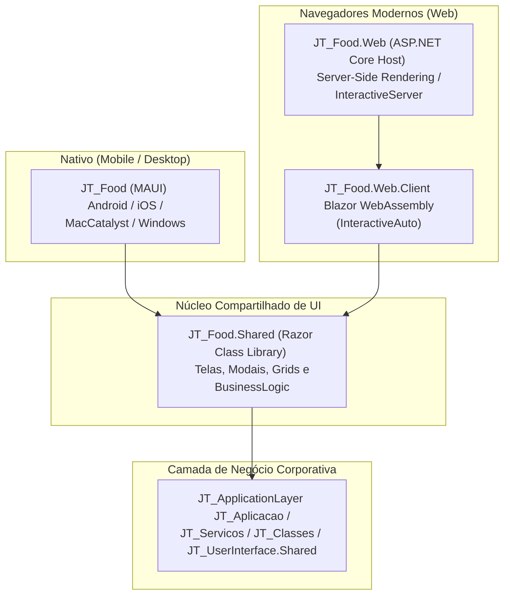

# JT_Food 🍽️

[](https://dotnet.microsoft.com/)
[](https://dotnet.microsoft.com/apps/aspnet/web-apps/blazor)
[](https://dotnet.microsoft.com/apps/maui)
[](LICENSE)
[](https://github.com/mrjalves/JT_Food/actions/workflows/deploy.yml)

Sistema omnicanal para gestão de restaurantes, bares, lanchonetes e operações de *food service*, unificando controle de salão (mesas e comandas), tela de produção na cozinha (KDS), baixa automática de insumos por FIFO, gestão de compras e frente de caixa (PDV).

O projeto é desenvolvido sobre o **.NET 10** e implementa uma arquitetura multiplataforma orientada a componentes compartilhados (**Shared Razor Class Library**), rodando tanto na **Web** (via Blazor Web App com renderização híbrida `InteractiveAuto`) quanto em **Dispositivos Móveis e Desktop** (Android, iOS, macOS e Windows via .NET MAUI Blazor Hybrid).

---

## 📑 Sumário

- [Visão Geral e Destaques](#-visão-geral-e-destaques)
- [Arquitetura da Solução](#-arquitetura-da-solução)
- [Módulos do Sistema](#-módulos-do-sistema)
- [Estrutura do Repositório](#-estrutura-do-repositório)
- [Como Executar Localmente](#-como-executar-localmente)
  - [Pré-requisitos](#pré-requisitos)
  - [Executando a Versão Web](#1-executando-a-versão-web-blazor-web-app)
  - [Executando a Versão Desktop / Mobile (MAUI)](#2-executando-a-versão-desktop--mobile-net-maui)
- [Configuração de Ambiente](#-configuração-de-ambiente)
- [Pipeline de CI/CD e Deploy](#-pipeline-de-cicd-e-deploy)
- [Documentação Técnica Detalhada](#-documentação-técnica-detalhada)

---

## 🌟 Visão Geral e Destaques

- **Interface Única, Múltiplas Plataformas:** 100% dos componentes e telas Razor são compartilhados entre o navegador e o aplicativo nativo via `JT_Food.Shared`.
- **Kitchen Display System (KDS):** Fila de pedidos da cozinha em tempo real com auto-refresh a cada 30 segundos, alertas e rastreabilidade passo a passo.
- **Controle de Estoque FIFO com Memória de Cálculo:** Baixa automática de ingredientes por ordem cronológica de lotes (lote mais antigo primeiro) e cálculo exato de CMV.
- **Frente de Caixa (PDV):** Abertura com saldo inicial, suprimentos, sangrias com justificativa, recebimento multi-moeda e conferência de quebra de caixa.
- **Multi-Tenant Nativo:** Identificação de cliente integrada com a retaguarda `JT_ApplicationLayer` via cabeçalho `X-Client-Config`.
- **Auto-Migração de Schema:** Sincronização automática de tabelas e índices dos módulos `Gestao`, `Restaurante` e `Food` ao iniciar a aplicação.

---

## 🏗 Arquitetura da Solução



Para mais detalhes arquiteturais, veja o documento [docs/ARQUITETURA.md](docs/ARQUITETURA.md).

---

## 🍕 Módulos do Sistema

| Módulo | Rota | Descrição |
| :--- | :--- | :--- |
| **Home** | `/` | Painel de controle com resumos e métricas rápidas. |
| **Mesas** | `/mesas` | Gestão visual do salão (Livre, Ocupada, Aguardando Pagamento, Reservada). |
| **Comandas** | `/comandas` | Abertura e acompanhamento de comandas e pedidos dos clientes. |
| **KDS** | `/kds` | Kitchen Display System com colunas "A Preparar" e "Em Preparo". |
| **Produção** | `/producao` | Baixa manual de insumos baseada em fichas técnicas e consumo FIFO. |
| **Menu** | `/menu` | Cardápio de produtos, categorias e precificação. |
| **Receitas** | `/receita` | Composição de fichas técnicas dos pratos e bebidas. |
| **Estoque** | `/estoque` | Saldo atualizado de insumos e matérias-primas. |
| **Compras** | `/compras` | Entrada de insumos com geração automática de lotes e custo médio ponderado. |
| **Caixa** | `/caixa` | Frente de caixa, sangrias, suprimentos e apuração de quebra. |
| **Configurações** | `/configuracoes` | Parâmetros de funcionamento e personalizações do restaurante. |

Para mais detalhes sobre as regras de negócio, consulte [docs/MODULOS_E_FLUXOS.md](docs/MODULOS_E_FLUXOS.md).

---

## 📁 Estrutura do Repositório

```text
JT_Food/
├── .github/
│   └── workflows/
│       └── deploy.yml                 # Pipeline de CI/CD para deploy automático via SSH
├── docs/
│   ├── ARQUITETURA.md                 # Arquitetura detalhada, render modes e DI
│   ├── MODULOS_E_FLUXOS.md            # Regras de negócio, KDS, FIFO e Caixa
│   └── DEPLOY_E_CONFIGURACOES.md      # Configurações, Nginx, systemd e secrets
├── scripts/
│   └── linux/
│       ├── setup-vps.sh               # Script de provisionamento automático da VPS
│       ├── jt_sistemas_food.service   # Serviço de background systemd
│       ├── nginx-jt_food.conf         # Configuração de proxy reverso com WebSockets
│       └── README_DEPLOY.md           # Guia operacional de deploy em VPS Linux
├── JT_Food/
│   ├── JT_Food/                       # Projeto nativo .NET MAUI (Android/iOS/Mac/Windows)
│   ├── JT_Food.Shared/                # Razor Class Library compartilhada (Páginas, Domínio e Regras)
│   │   ├── BusinessLogic/             # CaixaLogic, ProducaoLogic, KDSLogic, ComercialLogic, PromocaoLogic
│   │   ├── Components/                # Grids, Modais e PainelRelatorioIA
│   │   ├── Domain/                    # Entidades (Mesa, Comanda, RegraPromocao, ImpressoraRede) e Enums
│   │   ├── Layout/                    # MenuLateral e provedores de navegação
│   │   ├── Pages/                     # Telas do sistema (KDS, Mesas, Caixa, etc.)
│   │   └── Services/                  # Interfaces e implementações (ComandaOperacionalService, EscPosPrintService, AuthPerfilService, GeminiRelatorioService)
│   ├── JT_Food.Web/                   # Servidor ASP.NET Core, endpoints /health, /api/operacoes e host Blazor
│   ├── JT_Food.Web.Client/            # Cliente Blazor WebAssembly
│   └── JT_Food.Tests/                 # Testes unitários automatizados (xUnit)
├── global.json                        # Fixação da versão do .NET SDK
├── Directory.Build.props              # Propriedades globais de compilação e análise
├── .editorconfig                      # Padronização de estilo de código
├── LICENSE                            # Termos de licença proprietária
├── CONTRIBUTING.md                    # Diretrizes de contribuição e execução de testes
├── JT_Food.slnx                       # Arquivo de solução moderno do .NET
└── README.md                          # Este documento
```

---

## 🚀 Como Executar Localmente

### Pré-requisitos

1. **.NET SDK 10.0** ou superior instalado ([Download .NET](https://dotnet.microsoft.com/download)).
2. Para compilar a versão nativa MAUI:
   - Visual Studio 2022+ com a carga de trabalho *.NET Multi-platform App UI development*.
   - Ou workloads instalados via terminal: `dotnet workload install maui`.
3. Repositório irmão **`JT_ApplicationLayer`** clonado na mesma pasta raiz pai (ex: `../JT_ApplicationLayer`).

### 1. Executando a Versão Web (Blazor Web App)

```bash
# Navegue até a pasta do projeto Web
cd JT_Food/JT_Food.Web

# Restaure as dependências e inicie o servidor
dotnet run
```

Acesse o sistema no navegador através do endereço exibido no terminal (geralmente `http://localhost:5000` ou `https://localhost:7166`).

### 2. Executando a Versão Desktop / Mobile (.NET MAUI)

Para rodar como aplicação Desktop no Windows:
```bash
cd JT_Food/JT_Food
dotnet build -t:Run -f net10.0-windows10.0.19041.0
```

Para rodar no emulador Android:
```bash
cd JT_Food/JT_Food
dotnet build -t:Run -f net10.0-android
```

---

## ⚙️ Configuração de Ambiente

As configurações públicas de endpoint residem no `appsettings.json`, enquanto segredos de banco de dados e chaves de serviço devem ficar **exclusivamente no servidor Web** (`JT_Food.Web/appsettings.Production.json` ou variáveis de ambiente) — nunca nos projetos clientes (`JT_Food.Web.Client` ou `JT_Food` MAUI):

- **`Config:Conexao:BaseApiUrl`**: URL da API REST backend (`JT_API`).
- **`Config:Conexao:StringConexao`** *(Somente Servidor)*: String de conexão SQL Server ou variável `JT_FOOD_CONNECTION_STRING` para migração de schema sob demanda (`--migrate` ou `Config:AutoMigrateOnStartup=true`).
- **`Config:FirebaseConfig:AppMani`** *(Somente Servidor)*: Credenciais da Service Account no backend.
- **`GEMINI_API_KEY`** *(Somente Servidor)*: Chave de API para diagnóstico inteligente via proxy seguro `/api/gemini/*`.

Consulte [docs/DEPLOY_E_CONFIGURACOES.md](docs/DEPLOY_E_CONFIGURACOES.md) para o modelo completo.

---

## 🎯 Escopo Funcional e Roadmap Brasil

O **JT_Food** foca na operação interna de salão, comandas, KDS, ficha técnica/FIFO e controle gerencial de caixa. Itens atualmente fora do escopo nativo (planejados via integrações externas no ecossistema `JT_API`):
- Emissão fiscal direta (NFC-e / SAT / CF-e).
- Homologação TEF dedicado / Webhook PIX bancário direto no PDV.
- Integração nativa com marketplaces de delivery (iFood / Rappi).
- Impressão térmica ESC/POS em nuvem requer execução via app nativo MAUI na LAN do restaurante ou agente local de impressão.

---

## 🚢 Pipeline de CI/CD e Deploy

O deploy contínuo em servidor Linux é automatizado via GitHub Actions ([deploy.yml](.github/workflows/deploy.yml)).

A cada `push` na branch `master`:
1. Compilação e publicação da versão Web em modo `Release`.
2. Sincronização incremental dos binários para a VPS via `rsync` através de túnel SSH seguro.
3. Preservação de arquivos locais protegidos (`appsettings.Production.json`, bancos locais e uploads).
4. Reinicialização automática e verificação de saúde do serviço `jt_sistemas_food`.

Para configurar a VPS e as Secrets do GitHub, siga o [Guia de Deploy](docs/DEPLOY_E_CONFIGURACOES.md) ou o passo a passo em [scripts/linux/README_DEPLOY.md](scripts/linux/README_DEPLOY.md).

---

## 📚 Documentação Técnica Detalhada

- 🏛️ [Arquitetura da Solução](docs/ARQUITETURA.md): Estrutura multi-projeto, ciclo de vida do Blazor `InteractiveAuto`, suporte MAUI Hybrid e injeção de dependências.
- ⚙️ [Módulos e Fluxos de Negócio](docs/MODULOS_E_FLUXOS.md): Estados do KDS, algoritmo de consumo FIFO, cálculo de quebra de caixa e gestão de mesas.
- 🚀 [Infraestrutura e Deploy](docs/DEPLOY_E_CONFIGURACOES.md): Configuração de Nginx, serviço systemd, certificados SSL e pipeline do GitHub Actions.
- 🐧 [Guia Rápido VPS Linux](scripts/linux/README_DEPLOY.md): Passo a passo para execução do script de instalação no Ubuntu/Debian.
