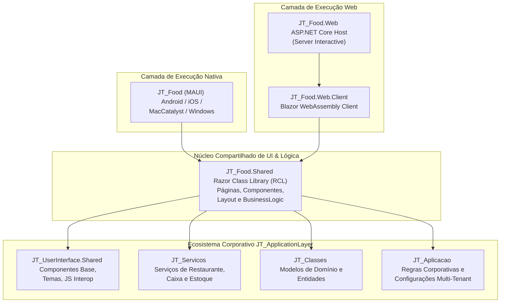
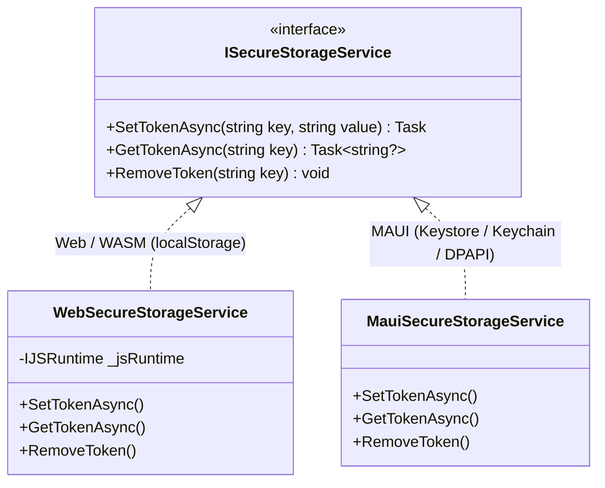

# Arquitetura da Solução - JT_Food

O **JT_Food** é um ecossistema completo para gestão de restaurantes, bares, lanchonetes e operações de *food service*, projetado sobre a plataforma **.NET 10**.

A aplicação adota uma arquitetura multiplataforma orientada a componentes compartilhados (**Shared Razor Class Library**), permitindo que **100% da interface do usuário (UI) e da lógica de apresentação** sejam executadas tanto em navegadores web modernos (via **Blazor Web App InteractiveAuto**) quanto em aplicativos nativos para desktop e dispositivos móveis (via **.NET MAUI Blazor Hybrid**).

---

## 1. Visão Geral dos Projetos na Solução

A solução `JT_Food.slnx` organiza o ecossistema em camadas e perfis de execução especializados:



### Detalhamento dos Projetos

| Projeto | SDK / Tipo | Descrição |
| :--- | :--- | :--- |
| **`JT_Food.Shared`** | `Microsoft.NET.Sdk.Razor` | Núcleo de componentes Razor, telas do sistema (`Pages/`), componentes reutilizáveis (`Components/`), menu lateral (`Layout/`) e orquestradores de regras (`BusinessLogic/`). |
| **`JT_Food.Web`** | `Microsoft.NET.Sdk.Web` | Servidor ASP.NET Core que hospeda a aplicação web, gerencia SSR (Server-Side Rendering), renderização interativa no servidor (`InteractiveServer`), auto-migração de banco e entrega de ativos estáticos. |
| **`JT_Food.Web.Client`** | `Microsoft.NET.Sdk.BlazorWebAssembly` | Pacote WebAssembly executado no navegador do usuário quando ativado o modo `InteractiveAuto`. Garante alta responsividade e execução no cliente. |
| **`JT_Food` (MAUI)** | `Microsoft.NET.Sdk.Razor` (`<UseMaui>true</UseMaui>`) | Aplicativo nativo empacotado para Android, iOS, macOS e Windows. Utiliza `BlazorWebView` para projetar a interface do `JT_Food.Shared` com acesso a recursos nativos de hardware e armazenamento seguro do SO. |

---

## 2. Padrões de Renderização e Estratégia Híbrida

### 2.1. Blazor Web App (InteractiveAuto)

No ambiente web ([Program.cs](file:///c:/Users/sirja/source/repos/mrjalves/JT_Food/JT_Food/JT_Food.Web/Program.cs)), o aplicativo é configurado para utilizar o modo híbrido **InteractiveAuto**:

```csharp
builder.Services.AddRazorComponents()
    .AddInteractiveServerComponents()
    .AddInteractiveWebAssemblyComponents();
```

- **Primeira Carga (Server-Side Pre-rendering):** A página é renderizada instantaneamente pelo servidor via `InteractiveServer`, proporcionando tempo de resposta inicial rápido (Time to Interactive) e sem telas de carregamento em branco.
- **Transição Transparente:** Em segundo plano, os binários WebAssembly (`JT_Food.Web.Client`) são baixados no navegador. Nas visitas subsequentes, a execução migra automaticamente para o cliente WebAssembly, aliviando o uso de conexões SignalR no servidor.

### 2.2. .NET MAUI Blazor Hybrid

No ambiente mobile e desktop ([MauiProgram.cs](file:///c:/Users/sirja/source/repos/mrjalves/JT_Food/JT_Food/JT_Food/MauiProgram.cs)), a tela principal [MainPage.xaml](file:///c:/Users/sirja/source/repos/mrjalves/JT_Food/JT_Food/JT_Food/MainPage.xaml) renderiza o controle `BlazorWebView`:

```xml
<BlazorWebView x:Name="blazorWebView" HostPage="wwwroot/index.html">
    <BlazorWebView.RootComponents>
        <RootComponent Selector="#app" ComponentType="{x:Type shared:Routes}" />
    </BlazorWebView.RootComponents>
</BlazorWebView>
```

- A UI executa dentro de uma Web View nativa do sistema operacional (Edge WebView2 no Windows, Chrome WebKit no Android, WKWebView no iOS/macOS).
- O código C# executa **diretamente no processo nativo**, sem compilação para WebAssembly e sem overhead de conexão de rede para renderização de tela.

---

## 3. Abstração de Serviços e Injeção de Dependências

Para manter o `JT_Food.Shared` agnóstico à plataforma de execução, serviços específicos de ambiente são abstraídos através de contratos interfaces.

### 3.1. Armazenamento Seguro de Tokens (`ISecureStorageService`)

A persistência de autenticação e credenciais de sessão utiliza implementações direcionadas:



- **Ambiente Web:** Implementado por [WebSecureStorageService.cs](file:///c:/Users/sirja/source/repos/mrjalves/JT_Food/JT_Food/JT_Food.Shared/Services/WebSecureStorageService.cs), com tratamento seguro para cenários de *pre-rendering* onde o JS Interop ainda não está inicializado.
- **Ambiente MAUI:** Implementado por [MauiSecureStorageService.cs](file:///c:/Users/sirja/source/repos/mrjalves/JT_Food/JT_Food/JT_Food/Services/MauiSecureStorageService.cs), utilizando a criptografia de hardware do dispositivo (`Microsoft.Maui.Storage.SecureStorage`).

### 3.2. Registro de Serviços de Domínio (`DependencyInjection.cs`)

O método de extensão [AddJTFoodServices](file:///c:/Users/sirja/source/repos/mrjalves/JT_Food/JT_Food/JT_Food.Shared/DependencyInjection.cs) centraliza o registro de todos os serviços de suporte, orquestradores de regras e layouts:

```csharp
public static IServiceCollection AddJTFoodServices(this IServiceCollection services)
{
    // Provedores de Navegação e Configurações
    services.AddScoped<IMenuProvider, MenuLateral>();
    services.AddScoped<IModuloMenuProvider, MenuLateral>();
    services.AddScoped<IConfiguracaoTabProvider, RestauranteConfigTabProvider>();

    // Serviços do Módulo Restaurante (JT_Servicos)
    services.AddScoped<MesaService>();
    services.AddScoped<ComandaService>();
    services.AddScoped<ProdutoRestauranteService>();
    services.AddScoped<CompraRestauranteService>();
    services.AddScoped<ItemComandaService>();
    services.AddScoped<AdicionaisItemComandaService>();
    services.AddScoped<PagamentoComandaService>();
    services.AddScoped<CaixaService>();
    services.AddScoped<MovimentacaoCaixaService>();

    // Serviços de Insumos e Produção
    services.AddScoped<InsumoService>();
    services.AddScoped<LoteInsumoService>();
    services.AddScoped<ReceitaService>();
    services.AddScoped<ProducaoService>();
    services.AddScoped<MemoriaCalculoService>();
    services.AddScoped<ItemCompraService>();

    // Orquestradores de Lógica de Negócios (BusinessLogic)
    services.AddScoped<CaixaLogic>();
    services.AddScoped<ProducaoLogic>();
    services.AddScoped<KDSLogic>();
    services.AddScoped<ComercialLogic>();

    return services;
}
```

---

## 4. Comunicação HTTP e Header Multi-Tenant

As chamadas às APIs de retaguarda (`JT_API`) utilizam instâncias de `HttpClient` configuradas com identificação de cliente (*Client Identifier*):

1. **Injeção do Header `X-Client-Config`:**
   Ao disparar requisições, o payload `ClientConfigPayload { ClientId = "JT_Food" }` é codificado em Base64 e injetado no cabeçalho `X-Client-Config`. Isso permite que o backend identifique o tenant correspondente e execute o isolamento de dados apropriado.
2. **Suporte a Emulador Android:**
   No MAUI, quando a aplicação roda sob Android e aponta para `localhost`, a URL base é ajustada automaticamente para `http://10.0.2.2:PORTA`, permitindo a comunicação com a API local em ambiente de desenvolvimento.

---

## 5. Orquestração de Migração de Banco de Dados

Na inicialização do backend Web ([Program.cs](file:///c:/Users/sirja/source/repos/mrjalves/JT_Food/JT_Food/JT_Food.Web/Program.cs#L53-L81)), a aplicação aciona o motor de sincronização automática de schema `ModuloMigrationOrchestrator`:

```csharp
var configCliente = new JT_Aplicacao.Config.ConfigCliente
{
    StringConexao = stringConexao,
    TipoBanco = tipoBanco,
    ModulosAtivos = new List<JT_Aplicacao.Classes.eModuloSistema>
    {
        JT_Aplicacao.Classes.eModuloSistema.Gestao,
        JT_Aplicacao.Classes.eModuloSistema.Restaurante,
        JT_Aplicacao.Classes.eModuloSistema.Food
    }
};

var orquestrador = new JT_Infra_Data.Schemas.ModuloMigrationOrchestrator();
orquestrador.Executar("JT_Food_Auto", configCliente);
```

- **Módulos Sincronizados:** `Gestao`, `Restaurante` e `Food`.
- **Tolerância a Falhas:** O orquestrador é envolvido em bloco `try/catch`. Caso o servidor de banco passe por manutenção temporária ou o usuário não possua privilégios de DDL, a aplicação registra o aviso nos logs e continua a inicialização sem interromper o serviço web.
