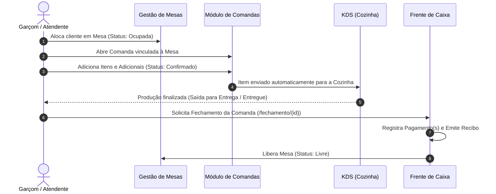
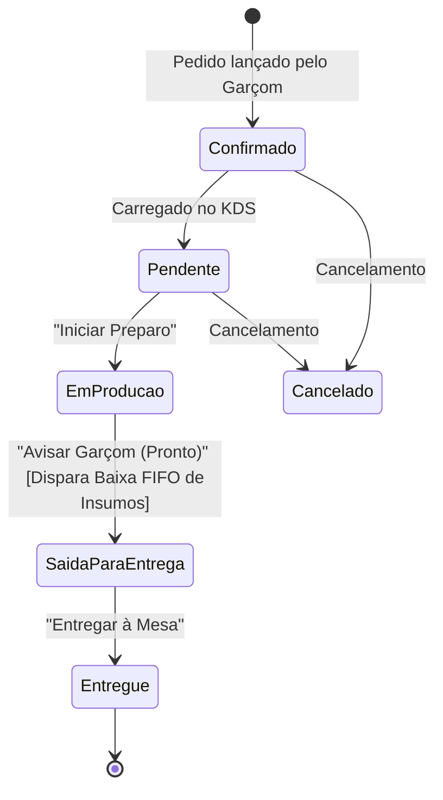
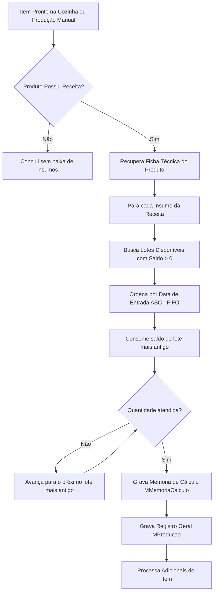
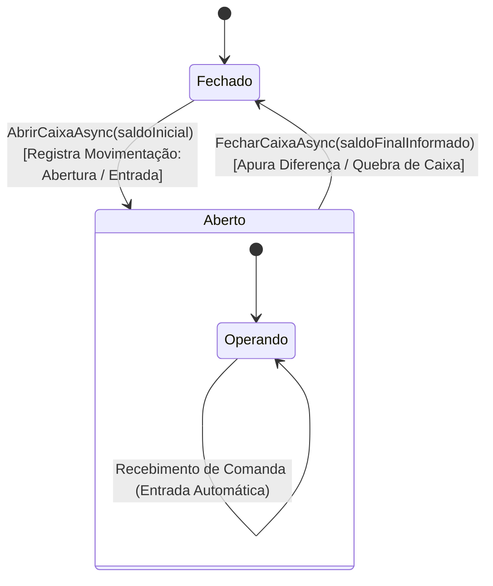

# Módulos Funcionais e Fluxos de Negócio - JT_Food

O **JT_Food** unifica todo o ciclo operacional de um estabelecimento gastronômico — desde a recepção e abertura de mesas até a produção na cozinha, baixa de insumos por FIFO, gestão de compras e fechamento de caixa.

Este documento detalha o funcionamento de cada módulo, as máquinas de estado e as regras de negócio implementadas.

---

## 1. Mapa de Navegação e Módulos

Os módulos estão registrados em [MenuLateral.cs](file:///c:/Users/sirja/source/repos/mrjalves/JT_Food/JT_Food/JT_Food.Shared/Layout/MenuLateral.cs):

| Rota | Módulo / Tela | Descrição | Componente Principal |
| :--- | :--- | :--- | :--- |
| `/` | **Home** | Dashboard com indicadores operacionais rápidos | [Home.razor](file:///c:/Users/sirja/source/repos/mrjalves/JT_Food/JT_Food/JT_Food.Shared/Pages/Home.razor) |
| `/mesas` | **Mesas & Salão** | Monitoramento e gestão do salão e ocupação de mesas | [Mesas.razor](file:///c:/Users/sirja/source/repos/mrjalves/JT_Food/JT_Food/JT_Food.Shared/Pages/Mesas.razor) |
| `/comandas` | **Comandas** | Abertura, consulta e edição de comandas/pedidos | [VerComandas.razor](file:///c:/Users/sirja/source/repos/mrjalves/JT_Food/JT_Food/JT_Food.Shared/Pages/VerComandas.razor) |
| `/fechamento/{id}` | **Fechamento de Comanda** | Checkout, conferência de itens e registro de pagamentos | [FechamentoPedido.razor](file:///c:/Users/sirja/source/repos/mrjalves/JT_Food/JT_Food/JT_Food.Shared/Pages/FechamentoPedido.razor) |
| `/kds` | **KDS (Kitchen Display)** | Painel em tempo real para a cozinha e expedição | [KDS.razor](file:///c:/Users/sirja/source/repos/mrjalves/JT_Food/JT_Food/JT_Food.Shared/Pages/KDS.razor) |
| `/menu` | **Cardápio / Menu** | Cadastro de produtos comercializados, categorias e preços | [Menu.razor](file:///c:/Users/sirja/source/repos/mrjalves/JT_Food/JT_Food/JT_Food.Shared/Pages/Menu.razor) |
| `/receita` | **Fichas Técnicas** | Vinculação de insumos e proporções necessárias para produzir cada item | [Receita.razor](file:///c:/Users/sirja/source/repos/mrjalves/JT_Food/JT_Food/JT_Food.Shared/Pages/Receita.razor) |
| `/estoque` | **Insumos & Estoque** | Consulta de matérias-primas e saldo disponível | [Estoque.razor](file:///c:/Users/sirja/source/repos/mrjalves/JT_Food/JT_Food/JT_Food.Shared/Pages/Estoque.razor) |
| `/compras` | **Compras / Entradas** | Registro de aquisição de insumos de fornecedores | [Compras.razor](file:///c:/Users/sirja/source/repos/mrjalves/JT_Food/JT_Food/JT_Food.Shared/Pages/Compras.razor) |
| `/producao` | **Produção Manual** | Apontamento avulso de produção com baixa FIFO de insumos | [Producao.razor](file:///c:/Users/sirja/source/repos/mrjalves/JT_Food/JT_Food/JT_Food.Shared/Pages/Producao.razor) |
| `/caixa` | **Controle de Caixa** | Abertura, fechamento, sangrias, suprimentos e conferência | [Caixa.razor](file:///c:/Users/sirja/source/repos/mrjalves/JT_Food/JT_Food/JT_Food.Shared/Pages/Caixa.razor) |
| `/configuracoes` | **Configurações** | Parâmetros operacionais do módulo Food Service | [Configuracoes.razor](file:///c:/Users/sirja/source/repos/mrjalves/JT_Food/JT_Food/JT_Food.Shared/Pages/Configuracoes.razor) |

---

## 2. Fluxo Operacional de Atendimento (Salão, Mesa e Comanda)

### 2.1. Gestão de Mesas
- Entidade `Mesa` com campos: `Identificacao`, `Capacidade`, `Status`.
- O enum `StatusMesa` define 4 estados:
  1. `Livre`: Mesa disponível para receber clientes.
  2. `Ocupada`: Há clientes consumindo com comanda ativa.
  3. `AguardandoPagamento`: Conta solicitada, aguardando liquidação no caixa.
  4. `Reservada`: Mesa com reserva antecipada.

### 2.2. Gestão de Comandas
- Permite comandas avulsas (ex: balcão/delivery) ou vinculadas a mesas específicas.
- Itens da comanda (`MItemComanda`) possuem controle de quantidade, valor unitário e opcionais vinculados (`MAdicionaisItemComanda`).
- Fechamento de comanda com suporte a divisão de pagamento (múltiplas formas de pagamento: Dinheiro, Cartão de Crédito, Cartão de Débito, PIX).

---

## 3. Kitchen Display System (KDS)

O KDS ([KDS.razor](file:///c:/Users/sirja/source/repos/mrjalves/JT_Food/JT_Food/JT_Food.Shared/Pages/KDS.razor) e [KDSLogic.cs](file:///c:/Users/sirja/source/repos/mrjalves/JT_Food/JT_Food/JT_Food.Shared/BusinessLogic/KDSLogic.cs)) substitui comandas impressas por monitores inteligentes na cozinha e bar.

### 3.1. Máquina de Estados dos Itens

### 3.2. Características do KDS
- **Fila em Tempo Real:** Atualização automática periódica (timer a cada 30 segundos com descarte limpo via `IDisposable`).
- **Cards Informativos:** Exibição destacada do nome do produto, quantidade, tempo decorrido, mesa, observações do cliente e lista de adicionais/modificadores.
- **Rastreabilidade e Log:** A cada avanço de status, o sistema anexa uma entrada com data e hora no histórico do item:
  `[dd/MM HH:mm] StatusAnterior → NovoStatus`.
- **Gatilho de Produção:** Ao transicionar de `Em Produção` para `Saída para Entrega`, o sistema aciona automaticamente a `ProducaoLogic.ProcessarProducaoAsync`, realizando a baixa imediata no estoque de insumos.

---

## 4. Controle de Produção e Baixa de Insumos por FIFO

Implementado em [ProducaoLogic.cs](file:///c:/Users/sirja/source/repos/mrjalves/JT_Food/JT_Food/JT_Food.Shared/BusinessLogic/ProducaoLogic.cs).

### 4.1. Algoritmo FIFO (First-In, First-Out)
Quando um produto é produzido:

### 4.2. Rastreabilidade Contábil (`MMemoriaCalculo`)
Para cada lote consumido, o sistema grava um registro de memória de cálculo contendo:
- ID do Lote (`LoteInsumoId`)
- Quantidade exata extraída do lote
- Custo unitário do lote no momento da extração
- Custo total rateado
- Timestamp da baixa

Isso garante que o custo da mercadoria vendida (CMV) reflita com precisão o custo real de aquisição dos insumos consumidos.

---

## 5. Gestão de Compras e Custo Médio

Implementado em [ComercialLogic.cs](file:///c:/Users/sirja/source/repos/mrjalves/JT_Food/JT_Food/JT_Food.Shared/BusinessLogic/ComercialLogic.cs) e [ModalCompra.razor](file:///c:/Users/sirja/source/repos/mrjalves/JT_Food/JT_Food/JT_Food.Shared/Components/ModalCompra.razor):

1. **Entrada de Mercadorias (`MCompra` e `MItemCompra`):**
   - Registro de fornecedor, data e múltiplos itens em uma única transação.
2. **Criação de Novos Lotes (`MLoteInsumo`):**
   - Para cada insumo recebido, um novo lote é gerado com:
     - `QuantidadeInicial` e `QuantidadeDisponivel`
     - `CustoUnitario` e `CustoTotalLote`
     - `DataEntrada` (UTC)
3. **Recálculo do Custo Médio Ponderado:**
   - O sistema calcula a média ponderada de todos os lotes ativos do insumo:
     $$\text{Custo Médio} = \frac{\sum (\text{QuantidadeDisponivel} \times \text{CustoUnitario})}{\sum \text{QuantidadeDisponivel}}$$
   - O valor apurado é atualizado na ficha cadastral do insumo (`MInsumo.CustoMedio`).

---

## 6. Frente de Caixa e Tesouraria (PDV)

Implementado em [CaixaLogic.cs](file:///c:/Users/sirja/source/repos/mrjalves/JT_Food/JT_Food/JT_Food.Shared/BusinessLogic/CaixaLogic.cs) e [Caixa.razor](file:///c:/Users/sirja/source/repos/mrjalves/JT_Food/JT_Food/JT_Food.Shared/Pages/Caixa.razor):

### 6.1. Operações Suportadas
- **Abertura de Caixa:** Informação de operador e saldo inicial (fundo de troco). Bloqueia a abertura de múltiplos caixas simultâneos pelo mesmo terminal.
- **Sangria (Retirada):** Saída de dinheiro para cofre/tesouraria com justificativa obrigatória.
- **Suprimento (Aporte):** Entrada de reforço de troco.
- **Entrada Automática de Vendas:** Ao finalizar o pagamento de qualquer comanda em dinheiro ou outros meios, o `CaixaLogic` grava uma movimentação vinculando o ID da comanda.
- **Fechamento e Auditoria de Quebra:**
  $$\text{Saldo Final Calculado} = \text{Saldo Inicial} + \text{Total Entradas} - \text{Total Saídas}$$
  $$\text{Diferença (Quebra/Sobra)} = \text{Saldo Final Informado} - \text{Saldo Final Calculado}$$
  Os valores são consolidados no registro `MCaixa` com timestamp de encerramento.

---

## 7. Construtor Visual de Layout do Restaurante

O módulo de salão interativo ([Mesas.razor](file:///c:/Users/sirja/source/repos/mrjalves/JT_Food/JT_Food/JT_Food.Shared/Pages/Mesas.razor)) opera em dois modos distintos:

### 7.1. Modo Construtor (Exclusivo Gerente)
* **Editor Visual Drag-and-Drop:** Permite arrastar mesas e elementos estruturais no canvas utilizando coordenadas percentuais $(X\%, Y\%)$ salvas via `IMesaLayoutService`.
* **Caixa de Ferramentas:** Inserção imediata de:
  * Mesas Quadradas (2 e 4 lugares)
  * Mesas Redondas (2 e 4 lugares)
  * Mesas Retangulares (6 e 8 lugares)
  * Elementos estruturais: Balcão/Bar, Palco do Couvert Artístico, Frente de Caixa e Paredes/Divisórias.
* **Painel Inspetor:** Ajuste de número/identificação da mesa, capacidade de pessoas, rotação ($0^\circ, 90^\circ, 180^\circ, 270^\circ$) e largura/altura.
* **Ambientes Múltiplos:** Abas dinâmicas para gerenciar o layout de múltiplos setores (*Salão Principal*, *Varanda*, *Deck Externo*, *Piso Superior*).

### 7.2. Mapa Operacional em Tempo Real (Garçom e Caixa)
* Representação visual instantânea com semáforo de status:
  * 🟢 **Verde (Livre):** Mesa desocupada, pronta para receber novos clientes.
  * 🔵 **Azul (Ocupada):** Mesa em atendimento, exibindo quantidade de comandas ativas e subtotal acumulado.
  * 🟡 **Amarelo (Alerta de Inatividade):** Mesa sem novos pedidos há mais de $X$ minutos.
  * 🔴 **Vermelho (Aguardando Pagamento):** Conta solicitada ou em fechamento na frente de caixa.

---

## 8. Lançamento Rápido de Pedidos e Gestão de Comandas da Mesa

Projetado especificamente para uso com uma só mão em smartphones e tablets de garçons ([LancamentoRapido.razor](file:///c:/Users/sirja/source/repos/mrjalves/JT_Food/JT_Food/JT_Food.Shared/Components/Pedidos/LancamentoRapido.razor)):

### 8.1. Fluxos de Pedido
1. **Pedido Direto na Mesa:** Itens computados diretamente para a conta coletiva da mesa.
2. **Sub-comandas Individuais da Mesa:** Cada cliente na mesa possui a sua própria comanda individual vinculada (ex.: `Mesa 08` $\rightarrow$ `Comanda #12 - Pedro`, `Comanda #15 - Sofia`), facilitando a divisão individual no fechamento.
3. **Identificação Flexível:** Abertura por Número do Cartão Físico (`#105`), Nome do Cliente (`"Lucas"`) ou ambos.

### 8.2. Interface Tátil Ágil
* Barra de categorias rápidas com rolagem horizontal: **🔥 Promoções**, **🍺 Bebidas**, **🍟 Porções**, **🍔 Lanches**, **🍽️ Pratos** e **🍰 Sobremesas**.
* Steppers de incremento `+` e `-` com seleção de etiquetas pré-configuradas (*Sem cebola*, *Bem passado*, *Gelo e limão*, *Copos separados*).
* Botão flutuante **Enviar Pedido**, que simultaneamente grava o pedido, direciona os itens para as impressoras térmicas setoriais e projeta os pedidos na esteira do KDS.

---

## 9. Motor de Promoções, Happy Hour e Combos

Centralizado em [PromocaoLogic.cs](file:///c:/Users/sirja/source/repos/mrjalves/JT_Food/JT_Food/JT_Food.Shared/BusinessLogic/PromocaoLogic.cs) e gerenciado em [Menu.razor](file:///c:/Users/sirja/source/repos/mrjalves/JT_Food/JT_Food/JT_Food.Shared/Pages/Menu.razor):

* **Desconto Direto (De / Por):** Preço promocional fixo ativo manualmente.
* **Happy Hour Automático por Horário/Dia:** Preços reduzidos ativados automaticamente com base no dia da semana e janela de horário (ex.: *Quarta e Quinta das 17h00 às 20h00*).
* **Combos e Pacotes:** Agrupamentos de itens com valor promocional fechado (ex.: *Hambúrguer Artesanal + Batata Frita + Refrigerante Lata* por R$ 38,00).

---

## 10. Couvert Artístico e Fechamento Detalhado

Parametrizado em [Configuracoes.razor](file:///c:/Users/sirja/source/repos/mrjalves/JT_Food/JT_Food/JT_Food.Shared/Pages/Configuracoes.razor) e operado em [FechamentoPedido.razor](file:///c:/Users/sirja/source/repos/mrjalves/JT_Food/JT_Food/JT_Food.Shared/Pages/FechamentoPedido.razor):

* **Ativação:** Manual no ato de abertura/fechamento ou automática com base no horário programado de apresentações ao vivo.
* **Critério de Cobrança:** Multiplicação pelo número de pessoas sentadas à mesa ou cobrança individual por comanda.
* **Isenção com 1 Clique:** Opção imediata de isenção ou remoção do couvert antes da emissão da pré-conta.
* **Divisão de Conta:** Divisão automática entre $N$ pagantes e suporte a pagamentos combinados (ex.: R$ 50,00 no PIX + saldo no Débito).
* **Pré-conta ESC/POS:** Emissão térmica do resumo para conferência na mesa antes da liquidação final.

---

## 11. Direcionamento para Impressoras Térmicas e KDS

* Cadastro de impressoras térmicas via TCP/IP na porta `9100` em [Configuracoes.razor](file:///c:/Users/sirja/source/repos/mrjalves/JT_Food/JT_Food/JT_Food.Shared/Pages/Configuracoes.razor).
* Cada categoria ou produto possui sua impressora de destino vinculada.
* Ao confirmar o pedido, o serviço `IImpressaoRedeService` gera os comandos ESC/POS e envia para a impressora do setor:
  * **Bar:** Comanda de bebidas para o barman.
  * **Cozinha / Chapa:** Comanda de pratos quentes e lanches + projeção no monitor KDS.
* Tratamento de falhas de conexão com alerta visual e retenção na fila para reenvio.

---

## 12. Dashboard com Relatórios Executivos por IA

Disponível no painel inicial ([Home.razor](file:///c:/Users/sirja/source/repos/mrjalves/JT_Food/JT_Food/JT_Food.Shared/Pages/Home.razor)):

* **Autenticação Rápida por PIN:** Garçom opera com interface focada e barra inferior mobile; Gerente desbloqueia relatórios executivos e configurações completas.
* **Cards de KPIs em Tempo Real:** Faturamento Bruto, Faturamento Líquido, Ticket Médio, Total de Couvert, Total de Descontos e Ocupação do Salão.
* **Painel de IA (Gemini / Motor Local):**
  * Geração sob demanda de diagnósticos sobre produtos de maior margem e rotatividade.
  * Recomendações de combos e campanhas para horários ociosos.
  * Previsão de reposição de insumos com base no ritmo de consumo e estoque mínimo.

